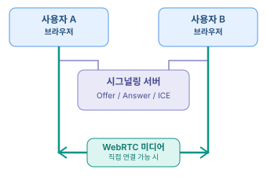

## WebRTC
> WebRTC(Web Real-Time Communication) : 브라우저나 애플리케이션 사이에서 **음성, 영상, 화면, 데이터를 실시간으로 송수신**할 수 있도록 지원하는 통신 기술

---

## 기본 연결 방식


- 시그널링 : 양쪽이 `Offer`와 `Answer`를 교환해 사용할 **미디어와 통신 조건을 협의**
- 실제 상용 서비스에서는 시그널링 기능을 `WebSocket` 등의 기술로 별도로 구현

---

## 관련 용어
- Peer : 연결에 참여하는 사용자 또는 장치
- SDP : 지원하는 미디어와 통신 조건을 설명하는 데이터 (Offer, Answer)
- ICE : 연결 가능한 네트워크 경로를 찾는 절차
- STUN 서버 : 외부에서 보이는 네트워크 주소 등을 알아내는데 도움 (외부 주소 확인, 직접 관여 x)
- TURN 서버 : 방화벽이나 NAT 환경으로 인해 직접 연결이 어려울 때 데이터를 중계
- Track : 영상 또는 음성의 개별 전송 단위

---

## 주요 메서드

### navigator.mediaDevices
- 브라우저에서 카메라, 마이크의 데이터를 가져오는 인터페이스
- 주요 메서드는 `getUserMedia()`, `getDisplayMedia()`, `enumerateDevices()` 가 있다.

#### getUserMedia
- 카메라와 마이크를 가져오는 메서드
- 실행 시 사용자의 브라우저에서 카메라와 마이크 권한 요청이 나타남
- 사용자가 허용 시 `MediaStream` 객체가 반환됨 (여러 `MediaStreamTrack`을 포함하는 컨테이너)

#### srcObject
- HTML의 `<video>`, `<audio>` 같은 미디어 태그에 `MediaStream` 객체를 직접 연결하기 위한 속성

<예시 코드>
```javascript
/* MediaStream 객체 */
const stream = await navigator.mediaDevices.getUserMedia({
  video: true,
  audio: true,
});

const videoElement = document.getElementById("localVideo");

videoElement.srcObject = stream;

stream.getTracks();       // 모든 트랙
stream.getVideoTracks();  // 비디오만 조회
stream.getAudioTracks();  // 오디오만 조회
stream.addTrack();        // 스트림에 트랙 추가
stream.removeTrack();     // 스트림에서 트랙 제거

stream.getTracks().length; // 보통 2 (audio + video)

stream.getTracks().forEach(track => track.stop()); // MediaStream에 포함된 모든 트랙을 종료

/* MediaStreamTrack 객체 */
const videoTrack = localStream.getVideoTracks()[0];
const audioTrack = localStream.getAudioTracks()[0];

videoTrack.enabled = false;  // 카메라 끄기
videoTrack.enabled = true;   // 카메라 켜기
videoTrack.readyState        // 기본값 "live" 출력 (트랙 동작 상태) 비활성화 시 "ended"

audioTrack.enabled = false;  // 마이크 음소거
audioTrack.enabled = true;   // 마이크 활성화
```

#### getDisplayMedia
- 사용자의 모니터 전체, 특정 애플리케이션 화면, 브라우저 탭 등을 공유하는 메서드
- 허용 시 반환되는 타입은 `MediaStream` 으로 동일하지만 데이터 출처가 화면이다.

```javascript
const screenStream = await navigator.mediaDevices.getDisplayMedia({
  video: true,
  audio: false,
});
```